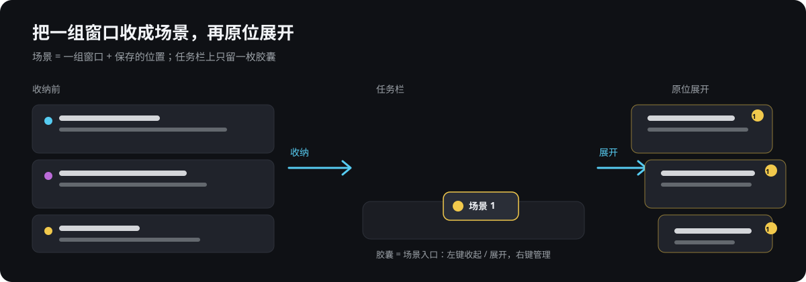
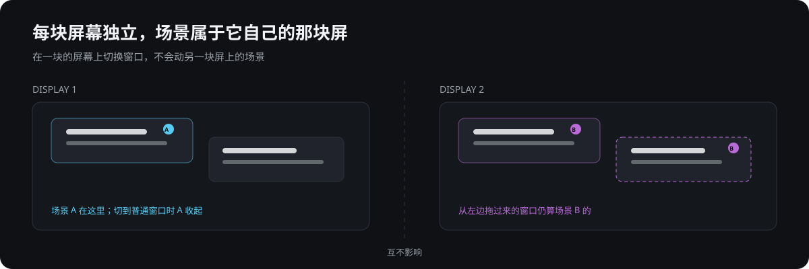

# 任务栏收纳 · TaskbarDrawer

把一组正在用的窗口「收」进任务栏上的一枚小胶囊，点一下原样展开。每次收纳都会自动存成一个**场景**，关掉之后还能按保存的位置一键拉起。

> 程序里只有两个概念：● **场景** = 一组窗口 + 保存的位置；**单窗口模式** = 每个场景当成一个窗口来切换。

> Windows 11 不允许第三方程序往任务栏里塞控件，所以胶囊是一枚紧贴任务栏的无边框置顶小窗：视觉上贴着任务栏，行为上可点击。

## 下载

[下载最新版](https://github.com/Simiely/taskbar-drawer/releases/latest) · Windows 10 / 11 x64 · 需要 [.NET 8 Desktop Runtime](https://dotnet.microsoft.com/download/dotnet/8.0)（框架依赖单文件，不内置运行时）



## 功能

- **新建场景**：`Ctrl+Alt+Shift+D` 把当前显示器上可见的窗口收成一个新场景并自动保存；这块屏幕上没有可收的窗口时再按一次，展开这块屏幕上最近的场景
- **场景胶囊**：每个场景一枚胶囊贴在任务栏（横排 / 竖排都跟得住），显示场景自己选的颜色圆点（可选数字 1–9）；静止时背景全透明，鼠标悬停才叠一层半透明灰（已展开的场景常驻一层更淡的灰），视觉上和任务栏按钮一致；左键收起 / 展开，右键：重命名 / 关闭窗口 / 删除场景；窗口关掉后胶囊作为「已关闭」留下，点一下按保存的位置重新打开
- **任务栏带场景标识**：场景展开期间，成员的窗口图标变成「角上的彩色圆点 / 数字 + 程序原图标」的合成图标，一眼看出这个窗口属于哪个场景；收起 / 删除场景后自动还原。标识默认在右上角，位置（左上 / 右上）和大小、原图标大小都可在主面板「外观」里调（两个滑块并排一行，默认 90% / 55%）
- **场景详情**：主面板场景行点「详情」，在面板旁展开详情窗（初始约半屏高，内容多时用窗内深色细滚动条，右下角 ◢ 可手动拉高）；可以换场景标识（颜色、数字 1–9、左上 / 右上）、单独移除窗口，或从「这块屏幕上的全部窗口」里逐项追加（已在当前场景 / 属于其它场景的也会列出并说明原因）；8 个颜色都能右键改成任意颜色（所有场景共用），旁边的「恢复默认」一键还原默认配色。移除 / 追加会立刻同步到正在运行的场景：展开中的窗口留在原位，收在收纳区的窗口会放回桌面
- **单窗口模式**：每个场景算一个窗口；切到场景里的任意窗口时同场景窗口一起保留，切到场景外时整个场景收回胶囊；手动最小化某个窗口会保持最小化，不会被切回来时弹回
- **多显示器**：每块屏幕完全独立——在一块的屏幕上切换窗口，不会动另一块屏上的窗口或场景；收纳、展开、收起也默认只作用于当前操作的显示器。单窗口模式下场景算一个窗口，并且属于它<b>自己那块屏幕</b>（收纳时确定）：成员被拖到别的屏幕也仍属于原场景、仍算原屏的窗口；要换屏就解散场景、在新屏重新收纳
- **主面板**：双击托盘图标打开（左键单击切换单窗口模式），查看场景列表、切换开关、改热键；顶部横条和面板空白 / 文字处都能拖动面板，拖动后记住位置；右上角「说明」打开带矢量示意图与编号标注的使用说明
- **细节**：开机自启、深色托盘菜单、单文件发布、崩溃日志



## 系统要求

- Windows 10 / 11 x64（开发与验证环境：Windows 11 24H2，横排与竖排任务栏）
- [.NET 8 Desktop Runtime](https://dotnet.microsoft.com/download/dotnet/8.0)（框架依赖的单文件发布，不内置运行时）

## 快速开始

1. 下载 `TaskbarDrawer.exe`，放到固定目录（建议 `%LOCALAPPDATA%\Programs\TaskbarDrawer`）
2. 双击运行：托盘出现图标（没有收纳内容时任务栏上还没有胶囊）
3. 打开几个窗口，按 `Ctrl+Alt+Shift+D` → 窗口收进胶囊，自动生成「场景 1」
4. 左键点胶囊 → 原位展开；再点 → 收起
5. 右键胶囊 → 重命名，给场景起个好记的名字；之后关掉窗口也能点胶囊按位置重新打开

> 首次运行会提示：Win11 默认把新托盘图标收进折叠区（`^`）。

## 从源码构建

```powershell
dotnet build src/TaskbarDrawer/TaskbarDrawer.csproj -c Release

dotnet test tests/TaskbarDrawer.Tests/TaskbarDrawer.Tests.csproj -c Release

dotnet publish src/TaskbarDrawer/TaskbarDrawer.csproj -c Release -r win-x64 `
  --self-contained false -p:PublishSingleFile=true -o publish
```

产物是单个 `publish\TaskbarDrawer.exe`（约 550 KB，需要 .NET 8 运行时）。

做可直接下载的发布包：

```powershell
powershell -NoProfile -ExecutionPolicy Bypass -File tools\release.ps1
```

脚本会跑构建 / 测试、生成 `dist\TaskbarDrawer-<版本>-win-x64.zip`（exe + 使用说明 + LICENSE）并打印 SHA256。

## 命令行

| 命令 | 作用 |
| --- | --- |
| `TaskbarDrawer.exe` | 启动并常驻托盘；重复启动会唤起已运行实例的主面板 |
| `TaskbarDrawer.exe --probe` | 只读打印候选窗口（句柄 / PID / 类名 / 矩形），排查「哪些窗口会被收纳」 |
| `TaskbarDrawer.exe --help` | 打印用法 |

## 数据与日志

全部在 `%LOCALAPPDATA%\TaskbarDrawer\`（日志优先放程序目录）：

| 文件 | 内容 |
| --- | --- |
| `settings.json` | 热键、面板位置、单窗口模式、开机自启、图标 / 标识尺寸 |
| `saved-groups.json` | 场景：软件路径 + 窗口位置 + 场景标识（颜色 / 数字 / 位置） |
| `recovery.json` | 当前被隐藏的窗口，异常退出后下次启动自动救回 |
| `logs\` | 程序目录下的 `app-yyyyMMdd.log`，按天分文件、只保留最近 1 天；程序目录不可写时退回 `%LOCALAPPDATA%\TaskbarDrawer\logs` |

删掉整个目录即可恢复出厂设置。

## 已知限制

- 收纳的是普通桌面窗口；UWP、管理员权限更高的窗口可能收不进去
- 胶囊与 Win11 任务栏共用 topmost 波段（Win11 已移除 DeskBand，无法真正嵌进任务栏），任务栏被点击后会短暂压在上面；前台一变化就会自动复位，最坏 0.25 秒
- 胶囊只贴在主任务栏：开启「在所有显示器上显示任务栏」时，副屏任务栏没有胶囊入口，副屏上的场景请用热键或主面板操作
- 面板位置以 DIP 记忆，双屏不同缩放比例时可能偏移（首次定位按目标屏 DPI 计算，恢复位置时会拉回工作区）
- 场景按 exe 路径重新启动；同路径软件已卸载时该项会被跳过
- 场景标识是画进窗口图标的合成图标（圆点 / 数字叠在程序图标的角上），不是任务栏上的独立控件；任务栏处于「始终合并按钮」时只显示图标，正好能看全
- 不需要管理员权限，也不修改任何系统设置

## 文档

- [AGENTS.md](AGENTS.md) — 给 AI / 未来的自己：技术栈、关键坑、约定、常用命令
- [DEVELOPMENT.md](DEVELOPMENT.md) — 项目概览、架构总览、问题索引
- [架构说明](docs/架构.md) — 分层、组合根、场景服务、单窗口模式与关键数据流
- [问题记录索引](docs/_generated/pitfalls.md) — 已解决问题的 TL;DR / 根因 / 方案
- [CHANGELOG.md](CHANGELOG.md) — 版本历史

## 致谢

- 场景标识是程序自己画的圆点和数字，不依赖 emoji 字体或第三方图形资源

维护规范见 [knowledge-base · 单项目规范](https://github.com/Simiely/knowledge-base/tree/main/模板库/单项目规范)。
